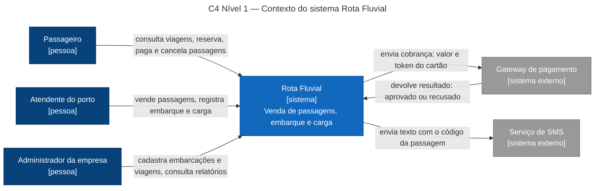
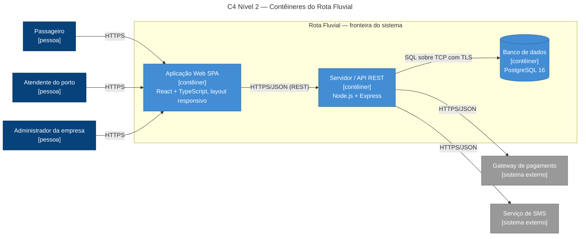
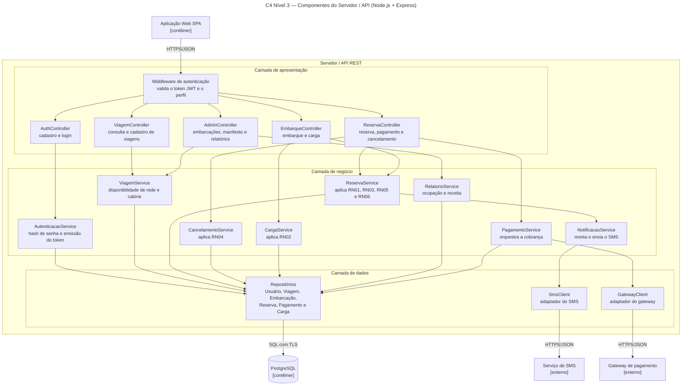
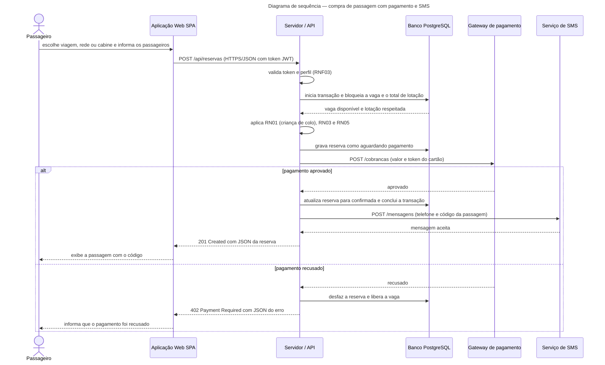

# Rota Fluvial — Venda de passagens e reservas de barcos regionais (Manaus ↔ interior)

**Disciplina:** Projetos de Sistemas — CIESA
**Trabalho em Equipe:** Requisitos e Arquitetura de um Sistema
**Tema sorteado:** Barcos regionais (Manaus ↔ interior)

## Equipe

| Integrante | Papel |
|---|---|
| [NOME 1] | Analista de requisitos |
| [NOME 2] | Analista de requisitos |
| [NOME 3] | Arquiteto (diagramas C4) |
| [NOME 4] | Responsável por decisões e comunicação (ADRs, HTTP, HTTPS) |
| [NOME 5] | Revisor de rastreabilidade (se a equipe tiver 5 integrantes) |

## Sumário

1. [Parte 1 — Requisitos](#parte-1--requisitos)
2. [Parte 2 — Documento de arquitetura](#parte-2--documento-de-arquitetura)
   - [2.1 Diagramas C4](#21-diagramas-c4-níveis-1-a-3)
   - [2.2 Registros de decisão (ADRs)](#22-registros-de-decisão-adrs)
   - [2.3 Comunicação cliente-servidor](#23-comunicação-cliente-servidor)
   - [2.4 Rastreabilidade](#24-rastreabilidade)

---

# Parte 1 — Requisitos

## 1.1 Descrição do sistema

A **Navegação Rio Negro** (empresa fictícia) opera barcos regionais que ligam Manaus a cidades do interior do Amazonas, como Parintins, Tefé e Coari. Hoje as passagens são vendidas apenas no balcão do porto, o que gera filas, vendas duplicadas de redes e cabines e pouco controle da lotação e da carga transportada. O sistema **Rota Fluvial** permite consultar viagens, comprar e cancelar passagens com reserva de **rede** ou **cabine**, controlar o embarque e registrar a carga de cada embarcação.

Tipos de usuário:

- **Passageiro:** consulta viagens, compra, paga e cancela passagens pela internet.
- **Atendente do porto:** vende passagens no balcão, registra o embarque e a carga transportada.
- **Administrador da empresa:** cadastra embarcações e viagens e acompanha a ocupação e a receita.

## 1.2 Tabela de requisitos

| Código | Tipo | Descrição | Prioridade |
|---|---|---|---|
| RF01 | Funcional | O sistema deve permitir que o passageiro consulte viagens informando origem, destino e data. | Alta |
| RF02 | Funcional | O sistema deve permitir que o passageiro se cadastre e faça login com e-mail e senha. | Alta |
| RF03 | Funcional | O sistema deve permitir que o passageiro reserve rede ou cabine em uma viagem, informando os dados de cada passageiro. | Alta |
| RF04 | Funcional | O sistema deve permitir que o passageiro pague a reserva com cartão de crédito ou débito. | Alta |
| RF05 | Funcional | O sistema deve permitir que o passageiro receba por SMS o código da passagem após a confirmação do pagamento. | Média |
| RF06 | Funcional | O sistema deve permitir que o passageiro cancele uma reserva e veja o valor a ser reembolsado. | Média |
| RF07 | Funcional | O sistema deve permitir que o atendente do porto venda passagens presencialmente no balcão. | Alta |
| RF08 | Funcional | O sistema deve permitir que o atendente do porto registre o embarque do passageiro a partir do código da passagem. | Alta |
| RF09 | Funcional | O sistema deve permitir que o atendente do porto registre a carga (descrição e peso) transportada em uma viagem. | Alta |
| RF10 | Funcional | O sistema deve permitir que o administrador cadastre embarcações com lotação de passageiros, quantidade de redes e cabines e limite de carga. | Alta |
| RF11 | Funcional | O sistema deve permitir que o administrador cadastre e altere viagens (rota, horário, embarcação e preços). | Alta |
| RF12 | Funcional | O sistema deve permitir que o administrador consulte o manifesto (lista de passageiros e carga) de uma viagem. | Média |
| RF13 | Funcional | O sistema deve permitir que o administrador gere relatórios de ocupação e receita por viagem e por período. | Baixa |
| RNF01 | Não funcional (desempenho) | A consulta de viagens deve responder em até 2 segundos para 95% das requisições, com 500 usuários simultâneos. | Alta |
| RNF02 | Não funcional (desempenho) | A confirmação de uma compra deve ser concluída em até 5 segundos em 95% dos casos no horário de pico, sem contar o tempo de resposta do gateway de pagamento. | Alta |
| RNF03 | Não funcional (segurança) | As senhas devem ser armazenadas com hash bcrypt (custo mínimo 10) e o token de acesso deve expirar em no máximo 15 minutos. | Alta |
| RNF04 | Não funcional (segurança) | 100% do tráfego entre cliente e servidor deve usar HTTPS com TLS 1.2 ou superior, e nenhum dado de cartão pode ser gravado no banco da empresa. | Alta |
| RNF05 | Não funcional (disponibilidade) | O sistema deve ter disponibilidade mínima de 99,5% por mês (no máximo cerca de 3 h 36 min de indisponibilidade mensal). | Alta |
| RNF06 | Não funcional (disponibilidade) | Deve haver backup completo diário, perda máxima de dados (RPO) de 1 hora e restabelecimento do serviço (RTO) em até 4 horas. | Média |
| RNF07 | Não funcional (usabilidade/acessibilidade) | Pelo menos 90% dos passageiros em teste de usabilidade devem concluir a compra em até 4 minutos, sem ajuda, e as telas devem atender ao nível AA da WCAG 2.1. | Média |
| RNF08 | Não funcional (compatibilidade) | O sistema deve funcionar nas duas últimas versões do Chrome, Firefox, Edge e Safari e em celulares Android 8+ com telas a partir de 360 px de largura. | Alta |
| RN01 | Regra de negócio | Criança de até 5 anos não paga passagem e viaja no colo do responsável, sem ocupar rede ou cabine, no máximo uma criança de colo por adulto. | Alta |
| RN02 | Regra de negócio | A carga total de uma viagem (bagagem despachada e encomendas) não pode ultrapassar o limite de carga da embarcação. | Alta |
| RN03 | Regra de negócio | O número de passageiros pagantes mais crianças de colo não pode ultrapassar a lotação da embarcação, e cada rede ou cabine só pode ser vendida uma vez por viagem. | Alta |
| RN04 | Regra de negócio | O cancelamento dá direito a reembolso integral até 24 h antes da partida, a 50% entre 24 h e 2 h antes, e a nenhum reembolso depois disso. | Média |
| RN05 | Regra de negócio | Menor de 16 anos só embarca acompanhado do responsável legal ou com autorização formal dele, conforme o Estatuto da Criança e do Adolescente. | Alta |
| RN06 | Regra de negócio | A passagem é nominal e intransferível, e o passageiro deve apresentar documento oficial com foto no embarque. | Média |

---

# Parte 2 — Documento de arquitetura

Arquitetura cliente-servidor: uma **aplicação web (SPA)** conversa por **HTTPS/JSON** com um **servidor/API REST**, que usa um **banco de dados relacional** e se integra a dois sistemas externos (gateway de pagamento e serviço de SMS).

## 2.1 Diagramas C4 (níveis 1 a 3)

### Nível 1 — Contexto



**Legenda:** caixa azul-escura = pessoa (usuário); caixa azul = sistema em desenvolvimento; caixa cinza = sistema externo; cada seta indica o sentido e o que trafega.

### Nível 2 — Contêineres



**Legenda:** caixa azul-escura = pessoa; caixa azul-clara = contêiner (com a tecnologia escolhida); cilindro = banco de dados; caixa cinza = sistema externo; o rótulo de cada seta é o protocolo usado.

### Nível 3 — Componentes do Servidor / API



**Legenda:** os três quadros internos são as camadas do servidor (apresentação, negócio e dados); cada caixa é um componente com sua responsabilidade; as caixas externas ao quadro "Servidor / API REST" são os contêineres e sistemas vizinhos; as setas indicam a direção da chamada.

## 2.2 Registros de decisão (ADRs)

### ADR-001 — Adotar banco de dados relacional (PostgreSQL) para reservas e carga

Status: aceita
Data: 2026-11-05

**Contexto**
RN03 exige que cada rede ou cabine seja vendida uma única vez por viagem e que a lotação não seja ultrapassada. RN02 exige que a soma da carga respeite o limite da embarcação. O RNF02 pede compra concluída em até 5 segundos no pico e o RNF01 pede consulta em até 2 segundos. Dois atendentes ou passageiros disputando a mesma rede ao mesmo tempo precisam ser tratados de forma consistente.

**Alternativas consideradas**

*Alternativa A — PostgreSQL (relacional)*
A favor: transações ACID e bloqueio de linha (`SELECT ... FOR UPDATE`) impedem a venda duplicada; restrições de integridade garantem os limites de RN02 e RN03; índices atendem às consultas do RNF01; consultas de relatório (RF13) são naturais em SQL.
Contra: escalar escrita horizontalmente é mais difícil; mudanças de esquema exigem migrações.

*Alternativa B — MongoDB (não relacional)*
A favor: esquema flexível; escala horizontal mais simples; bom para documentos de reserva.
Contra: transações entre várias coleções são mais limitadas e mais complexas de usar; a integridade de lotação e carga ficaria em código da aplicação; relatórios agregados exigem mais esforço.

**Decisão**
Escolhemos **PostgreSQL**, porque RN02 e RN03 dependem de consistência forte, ou seja, nunca vender duas vezes o mesmo lugar nem passar do limite de carga, e o RNF02 exige compra concluída dentro do tempo mesmo com concorrência.

**Consequências**
Positivas: garantia de consistência na reserva e no registro de carga; relatórios simples; ecossistema maduro e gratuito.
Negativas: a equipe precisa modelar o esquema com cuidado e manter migrações; se o volume crescer muito, será preciso réplicas de leitura ou particionamento, o que aumenta a complexidade e o custo.

---

### ADR-002 — Hospedar o sistema em nuvem pública com banco gerenciado

Status: aceita
Data: 2026-11-05

**Contexto**
O RNF05 exige disponibilidade de 99,5% ao mês e o RNF06 exige backup diário, RPO de 1 hora e RTO de 4 horas. A empresa é pequena, não tem equipe própria de infraestrutura e vende passagens 24 horas por dia, inclusive para quem está no interior.

**Alternativas consideradas**

*Alternativa A — Nuvem pública (região São Paulo) com PostgreSQL gerenciado*
A favor: SLAs publicados pelos grandes provedores costumam superar 99,5% (a confirmar no contrato escolhido); backup automático e recuperação para ponto no tempo atendem ao RNF06; sem compra de hardware.
Contra: custo recorrente, em geral cobrado em dólar; dependência do provedor; a latência até São Paulo é maior que a de um servidor local.

*Alternativa B — Servidor próprio na sede da empresa em Manaus*
A favor: controle total dos dados e do ambiente; sem mensalidade de hospedagem; latência local para o balcão do porto.
Contra: quedas de energia ou de internet derrubam o sistema inteiro; sem redundância seria difícil garantir 99,5%; backup, restauração e segurança física ficam por conta da empresa.

**Decisão**
Escolhemos **nuvem pública com banco gerenciado**, porque o RNF05 e o RNF06 são mais fáceis de cumprir e de comprovar com infraestrutura redundante e backups automáticos do que com um único servidor local.

**Consequências**
Positivas: alta disponibilidade e recuperação sem equipe de infraestrutura; capacidade ajustável nos horários de pico (RNF01 e RNF02).
Negativas: custo mensal contínuo e sujeito a variação cambial; dependência de um provedor (lock-in); os dados pessoais dos passageiros ficam em infraestrutura de terceiros, o que exige cuidado com a LGPD; todos os acessos dependem da internet.

---

### ADR-003 — Autenticar por token JWT de curta duração em vez de sessão no servidor

Status: aceita
Data: 2026-11-05

**Contexto**
O RNF03 exige senhas protegidas com bcrypt e tokens de acesso com validade de no máximo 15 minutos. O RF02 exige login de passageiros, e atendentes e administradores precisam de acesso diferenciado a funções como registro de carga e relatórios. O RNF05 pede alta disponibilidade, o que favorece um servidor que possa ser replicado sem estado compartilhado de sessão.

**Alternativas consideradas**

*Alternativa A — Sessão no servidor (cookie com ID de sessão guardado no banco)*
A favor: revogação imediata (basta apagar a sessão); modelo simples e conhecido.
Contra: toda requisição consulta o banco para validar a sessão; o estado compartilhado dificulta replicar o servidor; o banco vira ponto de pressão no horário de pico.

*Alternativa B — Token JWT de acesso (15 min) + refresh token*
A favor: o servidor valida o token sem consultar o banco, o que ajuda o RNF01 e o RNF02; o perfil (passageiro, atendente, administrador) vai dentro do token; o servidor continua sem estado, o que facilita replicar para o RNF05.
Contra: não é possível revogar um token de acesso antes de expirar; é preciso guardar e rotacionar o refresh token; a chave de assinatura precisa de gestão cuidadosa.

**Decisão**
Escolhemos **JWT de acesso com validade de 15 minutos e refresh token**, porque o RNF03 exige expiração curta e o servidor sem estado de sessão atende melhor ao RNF05 e ao desempenho do RNF01 e do RNF02.

**Consequências**
Positivas: validação rápida de cada requisição; servidor replicável; controle por perfil simples.
Negativas: uma conta bloqueada ainda pode usar o token por até 15 minutos; a implementação do refresh token e da gestão de chaves é mais complexa; o vazamento da chave de assinatura compromete todo o sistema.

## 2.3 Comunicação cliente-servidor

### Fluxo de requisição e resposta — compra de passagem (RF03, RF04 e RF05)



**Legenda:** seta cheia = requisição; seta tracejada = resposta; seta de uma entidade para ela mesma = processamento interno; o bloco `alt` mostra os dois caminhos possíveis (aprovado ou recusado).

### Requisições HTTP

Todas as requisições usam HTTPS. As rotas protegidas enviam `Authorization: Bearer <token JWT>`.

**Requisição 1 — Consultar viagens (RF01)**

```http
GET /api/viagens?origem=Manaus&destino=Parintins&data=2026-12-20
```

Resposta: **200 OK**

```json
{
  "viagens": [
    {
      "id": 42,
      "embarcacao": "B/M Rio Negro II",
      "origem": "Manaus",
      "destino": "Parintins",
      "partida": "2026-12-20T17:00:00-04:00",
      "chegada_prevista": "2026-12-21T06:00:00-04:00",
      "vagas": { "rede": 86, "cabine": 4 },
      "preco": { "rede": 180.00, "cabine": 420.00 }
    }
  ]
}
```

**Requisição 2 — Reservar e pagar passagem (RF03, RF04 e RF05)**

```http
POST /api/reservas
Authorization: Bearer <token do passageiro>
Content-Type: application/json
```

Corpo:

```json
{
  "viagem_id": 42,
  "acomodacao": "rede",
  "passageiros": [
    {
      "nome": "Maria da Silva",
      "documento": "00000000000",
      "data_nascimento": "1990-05-10",
      "telefone": "+5592999990000"
    },
    {
      "nome": "Pedro da Silva",
      "documento": "11111111111",
      "data_nascimento": "2022-03-14",
      "colo": true
    }
  ],
  "pagamento": { "metodo": "cartao", "token_cartao": "tok_abc123" }
}
```

Resposta: **201 Created**

```json
{
  "reserva_id": 8123,
  "codigo": "BRI-8123-XK",
  "status": "confirmada",
  "itens": [
    { "passageiro": "Maria da Silva", "acomodacao": "rede", "valor": 180.00 },
    { "passageiro": "Pedro da Silva", "acomodacao": "colo", "valor": 0.00 }
  ],
  "total": 180.00,
  "pagamento": { "metodo": "cartao", "status": "aprovado" },
  "notificacao": { "canal": "sms", "status": "enviada" }
}
```

**Requisição 3 — Registrar carga acima do limite (RF09) — caso de erro**

```http
POST /api/viagens/42/cargas
Authorization: Bearer <token do atendente>
Content-Type: application/json
```

Corpo:

```json
{
  "descricao": "Caixas de farinha de mandioca",
  "peso_kg": 1200,
  "remetente": "Comercial Tefé Ltda"
}
```

Resposta: **422 Unprocessable Entity**

```json
{
  "erro": {
    "codigo": "LIMITE_DE_CARGA_EXCEDIDO",
    "mensagem": "A carga total da viagem ultrapassaria o limite da embarcação.",
    "limite_kg": 30000,
    "carga_atual_kg": 29500,
    "carga_solicitada_kg": 1200
  }
}
```

**Requisição 4 — Cancelar reserva (RF06)**

Cancelamento feito entre 24 h e 2 h antes da partida (RN04: reembolso de 50%).

```http
DELETE /api/reservas/8123
Authorization: Bearer <token do passageiro>
```

Resposta: **200 OK**

```json
{
  "reserva_id": 8123,
  "status": "cancelada",
  "reembolso": {
    "percentual": 50,
    "valor": 90.00,
    "prazo_dias_uteis": 5
  }
}
```

### HTTPS

**Dados que precisam de proteção:**

- credenciais: e-mail, senha no login e tokens JWT e refresh token;
- dados pessoais dos passageiros: nome, documento, data de nascimento (inclusive de menores) e telefone, protegidos pela LGPD;
- dados de pagamento: o token do cartão enviado ao gateway;
- dados de reserva, manifestos e relatórios financeiros acessados por atendentes e administradores.

**O que o TLS garante:**

- **Confidencialidade:** o conteúdo trafega criptografado, e quem estiver na mesma rede Wi-Fi do porto, por exemplo, não consegue lê-lo.
- **Integridade:** qualquer alteração dos dados no caminho é detectada.
- **Autenticidade do servidor:** o certificado confirma ao navegador que ele está falando com o servidor verdadeiro da empresa, e não com um site falso.

**O que o TLS não resolve:** ele só protege os dados em trânsito. Por isso as senhas são guardadas com bcrypt (RNF03), os dados de cartão nunca são gravados (RNF04) e o banco é acessado por conexão com TLS (ADR-001 e ADR-002).

Medidas adotadas: TLS 1.2 ou superior (RNF04), redirecionamento de HTTP para HTTPS e cabeçalho HSTS.

## 2.4 Rastreabilidade

### RNF → decisão

| RNF | Decisão ou elemento do C4 que o atende |
|---|---|
| RNF01 (consulta em até 2 s) | ADR-001 (PostgreSQL com índices); ADR-003 (validação de token sem consulta ao banco); C4 N3: `ViagemService` e `Repositórios` |
| RNF02 (compra em até 5 s) | ADR-001 (transação com bloqueio de linha); ADR-003; C4 N3: `ReservaService`, `PagamentoService` e `GatewayClient` |
| RNF03 (bcrypt e token de 15 min) | ADR-003; C4 N3: `AutenticacaoService` e Middleware de autenticação |
| RNF04 (HTTPS/TLS e sem dados de cartão no banco) | C4 N2: todas as setas HTTPS e conexão ao banco com TLS; seção "HTTPS"; C4 N3: `GatewayClient` (só trafega o token do cartão) |
| RNF05 (99,5% de disponibilidade) | ADR-002 (nuvem com banco gerenciado); ADR-003 (servidor sem estado de sessão) |
| RNF06 (backup, RPO 1 h e RTO 4 h) | ADR-002 (backup automático e recuperação para ponto no tempo) |
| RNF07 (usabilidade e WCAG 2.1 AA) | C4 N2: Aplicação Web SPA (React, responsiva) |
| RNF08 (compatibilidade com navegadores e Android) | C4 N2: Aplicação Web SPA (interface web responsiva, sem instalação) |

### Requisição HTTP → RF

| Requisição | RF correspondente |
|---|---|
| 1 — `GET /api/viagens` | RF01 |
| 2 — `POST /api/reservas` | RF03, RF04 e RF05 |
| 3 — `POST /api/viagens/42/cargas` | RF09 (e RN02) |
| 4 — `DELETE /api/reservas/8123` | RF06 (e RN04) |

### ADR → requisito

| ADR | Requisitos que motivam a decisão |
|---|---|
| ADR-001 — PostgreSQL | RN02, RN03, RNF01, RNF02 |
| ADR-002 — Nuvem pública | RNF05, RNF06 |
| ADR-003 — JWT de curta duração | RNF03, RNF05, RNF01 |

### Regra de negócio → componente (extra)

| RN | Componente (C4 nível 3) |
|---|---|
| RN01, RN03, RN05, RN06 | `ReservaService` |
| RN02 | `CargaService` |
| RN04 | `CancelamentoService` |
